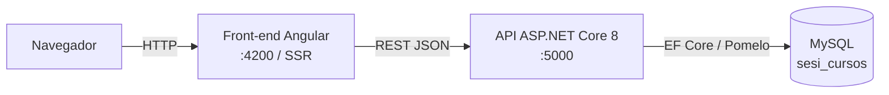
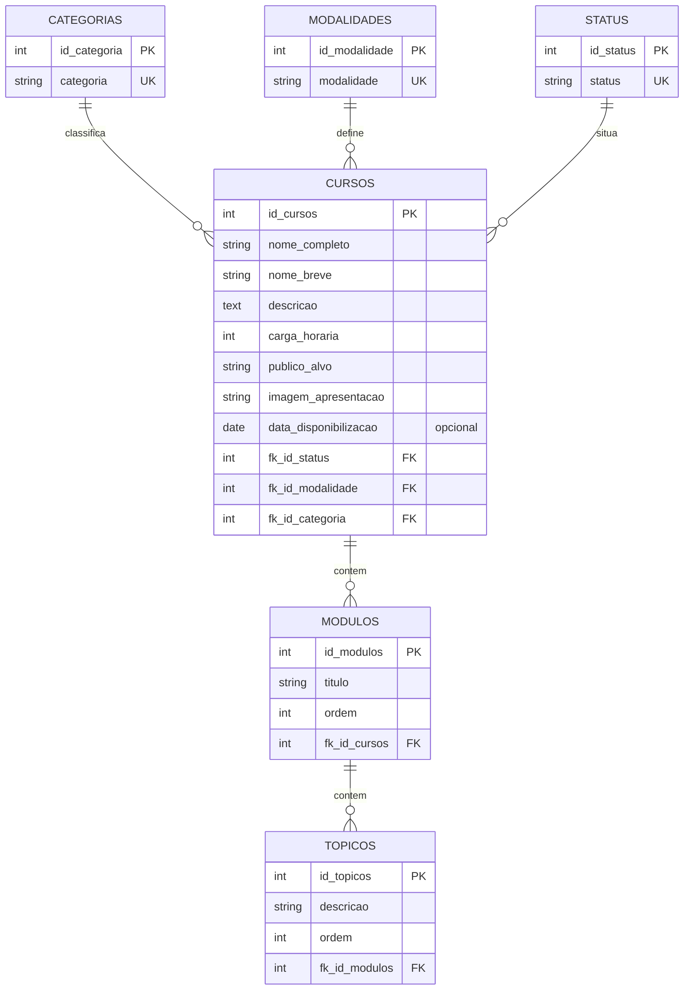

# Catálogo de Cursos SESI

Aplicação web para consultar, pesquisar e filtrar o catálogo de cursos de um ambiente educacional (Moodle) do CTED, com página de detalhes de cada curso. Projeto desenvolvido para o processo seletivo de **Desenvolvedor de Sistemas I – SESI-SP**.

| | |
|---|---|
| Aplicação publicada | _a preencher após a publicação (ver [Processo de publicação](#11-processo-de-publicação))_ |
| Documentação de uso de IA | [`USO_DE_IA.md`](USO_DE_IA.md) |

## Sumário

1. [Objetivo da aplicação](#1-objetivo-da-aplicação)
2. [Tecnologias utilizadas](#2-tecnologias-utilizadas)
3. [Arquitetura da solução](#3-arquitetura-da-solução)
4. [Estrutura das pastas](#4-estrutura-das-pastas)
5. [Instruções para execução](#5-instruções-para-execução)
6. [Configuração do banco](#6-configuração-do-banco)
7. [Endpoints](#7-endpoints)
8. [Modelo de dados](#8-modelo-de-dados)
9. [Estratégia de responsividade](#9-estratégia-de-responsividade)
10. [Decisões de acessibilidade](#10-decisões-de-acessibilidade)
11. [Processo de publicação](#11-processo-de-publicação)
12. [Limitações conhecidas](#12-limitações-conhecidas)

---

## 1. Objetivo da aplicação

Permitir que o usuário:

- **listar** os cursos disponíveis, consumindo a API;
- **pesquisar** cursos pelo nome (completo ou parcial);
- **filtrar** por categoria, modalidade e status, **combinando** os filtros com a pesquisa;
- ver a **quantidade de resultados** e **limpar** a pesquisa e os filtros com uma ação;
- **abrir os detalhes** de um curso (dados gerais, módulos e tópicos, aulas e dúvidas frequentes);
- receber retorno claro nos estados de **carregamento**, **nenhum resultado** e **erro**, com opção de tentar novamente;
- usar a interface em telas de diferentes tamanhos.

Cadastro, edição e exclusão de cursos pela interface **não** fazem parte do escopo. A integração com um ambiente Moodle real também não foi realizada (é um diferencial opcional do desafio).

## 2. Tecnologias utilizadas

| Camada | Tecnologia |
|---|---|
| Front-end | Angular 20 (componentes standalone, *signals*, detecção de mudanças *zoneless*, SSR com `@angular/ssr` e Express 5), Angular Material (barra de navegação), RxJS 7, TypeScript 5.9 |
| Back-end | C# / .NET 8, ASP.NET Core Web API, Entity Framework Core 8 com Pomelo (provedor MySQL), Swagger (Swashbuckle) |
| Banco de dados | **MySQL 8** (código aberto; os scripts também são compatíveis com MariaDB 10.5+) |
| Integração | API REST em JSON, com CORS habilitado |

## 3. Arquitetura da solução



- **Banco → API → Front:** o front nunca acessa o banco. Toda leitura passa pela API.
- **Filtragem em um único lugar:** pesquisa, filtros e paginação são feitos **na API** (`GET /api/cursos`), em uma só consulta que combina os critérios (E lógico). O front apenas envia os parâmetros e exibe `total` e `items`.
- **Estado do catálogo na URL:** o catálogo guarda pesquisa, filtros e página nos parâmetros da URL (`?busca=&categoria=&modalidade=&status=&pagina=`). Isso permite compartilhar a busca, atualizar a página sem perder o estado e usar o botão "voltar" do navegador.
- **Renderização por rota** (`app.routes.server.ts`): `/` e `/catalogo` são renderizadas no navegador; `/curso/:id` e rotas desconhecidas são renderizadas no servidor; `/fale-conosco` e `/area-aluno` são geradas no build.
- **Camadas da API:** `Controllers` (rotas HTTP) → `DTOs` (contratos de entrada e saída) → `Data/AppDbContext` (mapeamento EF Core) → `Models` (entidades).

### Rotas do front-end

| Rota | Conteúdo |
|---|---|
| `/` | Página inicial: destaque, carrossel com os principais cursos, números de impacto, depoimentos, chamada e "Fale conosco" |
| `/catalogo` | Catálogo completo com pesquisa, filtros, contagem, paginação e estados |
| `/curso/:id` | Detalhes do curso |
| `/fale-conosco` | Página de contato |
| `/area-aluno` | Aviso de que a área ainda não está disponível |
| qualquer outra | Página "Página não encontrada" |

## 4. Estrutura das pastas

```text
.
├── README.md
├── USO_DE_IA.md
├── banco/
│   ├── sesi_cursos.sql            # estrutura (banco, tabelas, chaves)
│   └── dados_cursos.sql           # dados fictícios (7 cursos, módulos e tópicos)
├── backend/
│   └── SesiCursos.Api/
│       ├── Controllers/           # Cursos, Módulos/Tópicos, Categorias, Modalidades, Status
│       ├── DTOs/                  # contratos de requisição e resposta
│       ├── Data/AppDbContext.cs   # mapeamento das tabelas
│       ├── Models/                # entidades
│       ├── Program.cs             # configuração (EF Core, CORS, Swagger)
│       └── appsettings.json       # conexão com o banco
└── frontend/
    └── sesi-cursos/
        ├── public/                # arquivos estáticos (fontes, ícones, imagens dos cursos)
        └── src/
            ├── index.html
            ├── styles.css         # fontes e estilos globais
            ├── server.ts          # servidor Express (SSR)
            └── app/
                ├── catalogo/      # listagem, pesquisa, filtros, paginação
                ├── curso/         # detalhes do curso
                ├── home/          # composição da página inicial
                ├── inicio/        # destaque + carrossel de cursos
                ├── resultado/ chamada/ depoimento/ fale-conosco/ footer/ menu/
                ├── nao-encontrado/# 404 e área do aluno
                ├── models/        # interfaces TypeScript (Curso, Modulo, ...)
                └── services/      # CursoService (acesso à API)
```

## 5. Instruções para execução

### Pré-requisitos

| Ferramenta | Versão |
|---|---|
| .NET SDK | 8.0 |
| Node.js | 20.19+ (ou 22.12+ / 24+), exigência do Angular 20 |
| MySQL | 8.0+ (ou MariaDB 10.5+) |

### Passo a passo (execução local)

**1. Banco de dados** (detalhes na [seção 6](#6-configuração-do-banco)):

```bash
mysql -u root -p < banco/sesi_cursos.sql
mysql -u root -p < banco/dados_cursos.sql
```

**2. API** (porta padrão 5000):

```bash
cd backend/SesiCursos.Api
dotnet run
```

Teste: abra `http://localhost:5000/api/cursos`. Para habilitar o Swagger (`/swagger`), execute com `ASPNETCORE_ENVIRONMENT=Development`:

```bash
# Linux / macOS / Git Bash
ASPNETCORE_ENVIRONMENT=Development dotnet run
# PowerShell
$env:ASPNETCORE_ENVIRONMENT="Development"; dotnet run
```

**3. Front-end** (porta 4200):

```bash
cd frontend/sesi-cursos
npm install
npm start
```

Abra `http://localhost:4200`. Deixe a API rodando em paralelo.

### Execução em modo de produção (SSR)

```bash
cd frontend/sesi-cursos
npm run build
NG_ALLOWED_HOSTS=localhost npm run serve:ssr:sesi-cursos   # http://localhost:4000
```

A variável `NG_ALLOWED_HOSTS` informa os domínios aceitos pelo servidor (proteção do Angular contra *host header injection*). Sem ela, o servidor registra um erro e entrega a página sem renderização no servidor. Em um servidor real, use o domínio publicado.

### Endereço da API usado pelo front

O endereço está definido em `frontend/sesi-cursos/src/app/services/curso.service.ts` (`http://localhost:5000/api/cursos`). Se a API rodar em outro endereço ou porta, altere esse arquivo.

## 6. Configuração do banco

1. **Crie a estrutura:** `banco/sesi_cursos.sql` cria o banco `sesi_cursos` (`utf8mb4` / `utf8mb4_unicode_ci`), as tabelas e as chaves. Pode ser executado mais de uma vez sem apagar dados.
2. **Carregue os dados fictícios:** `banco/dados_cursos.sql` **apaga e recria** os dados de exemplo; pode ser reexecutado para voltar ao estado inicial.
3. **Crie o usuário da aplicação** (o `appsettings.json` usa estas credenciais de desenvolvimento):

```sql
CREATE USER IF NOT EXISTS 'sesi'@'localhost' IDENTIFIED BY 'sesi123';
GRANT ALL PRIVILEGES ON sesi_cursos.* TO 'sesi'@'localhost';
FLUSH PRIVILEGES;
```

4. **Conexão:** `backend/SesiCursos.Api/appsettings.json`.

```json
"ConnectionStrings": { "DefaultConnection": "Server=localhost;Port=3306;Database=sesi_cursos;User=sesi;Password=sesi123;" },
"Database": { "ServerVersion": "8.0.36-mysql" }
```

Para usar outra conexão sem alterar o arquivo, defina a variável de ambiente `ConnectionStrings__DefaultConnection`. Para MariaDB, troque `Database:ServerVersion` (por exemplo, `10.11.6-mariadb`).

### Dados de exemplo

O script cria **7 cursos**, **4 categorias**, **3 modalidades** e **3 status**, com cargas horárias, públicos-alvo, módulos e tópicos diferentes. Todos os dados são fictícios.

| Curso | Carga | Modalidade | Categoria | Status | Disponível em |
|---|---|---|---|---|---|
| Introdução à Sustentabilidade e Gestão de Resíduos Industriais | 30h | Híbrido | Ciências da Natureza | Ativo | 01/04/2026 |
| Comunicação Assertiva e Escrita Técnica no Ambiente Profissional | 20h | EAD | Linguagens | Ativo | 15/04/2026 |
| Liderança e Gestão de Equipes de Alto Desempenho | 50h | Presencial | Ciências Humanas | Ativo | 01/05/2026 |
| Matemática Aplicada aos Processos Industriais | 60h | Presencial | Matemática | Em breve | 16/11/2026 |
| Segurança do Trabalho e Prevenção de Acidentes | 40h | Híbrido | Ciências da Natureza | Em breve | 01/02/2027 |
| Inglês Técnico para a Indústria | 80h | EAD | Linguagens | Inativo | 01/08/2025 |
| Ética e Cidadania no Mundo do Trabalho | 25h | Híbrido | Ciências Humanas | Inativo | não informada |

## 7. Endpoints

Base: `http://localhost:5000`. Respostas em JSON.

### Usados pelo front-end

| Método | Rota | Descrição |
|---|---|---|
| GET | `/api/cursos` | Lista cursos com pesquisa, filtros e paginação |
| GET | `/api/cursos/{id}` | Detalhes de um curso (`404` se não existir) |
| GET | `/api/cursos/{id}/modulos` | Módulos do curso, ordenados, com a lista de tópicos de cada um |

**`GET /api/cursos`: parâmetros (todos opcionais)**

| Parâmetro | Descrição |
|---|---|
| `busca` | Texto procurado no nome completo **ou** no nome breve (contém) |
| `statusId`, `modalidadeId`, `categoriaId` | Filtros por id; podem ser combinados entre si e com `busca` |
| `page` | Página, a partir de 1 (padrão 1) |
| `pageSize` | Itens por página, de 1 a 100 (padrão 10) |

Os resultados vêm ordenados pelo nome completo. A busca ignora maiúsculas e minúsculas (e, com o `collation` `utf8mb4_unicode_ci` do banco, também acentos).

**Resposta**

```json
{
  "page": 1,
  "pageSize": 10,
  "total": 7,
  "items": [
    {
      "id": 1,
      "nomeCompleto": "Introdução à Sustentabilidade e Gestão de Resíduos Industriais",
      "nomeBreve": "Sustentabilidade Industrial",
      "descricao": "…",
      "cargaHoraria": 30,
      "publicoAlvo": "…",
      "imagemApresentacao": "/assets/cursos/sustentabilidade.svg",
      "dataDisponibilizacao": "2026-04-01",
      "statusId": 1, "status": "Ativo",
      "modalidadeId": 2, "modalidade": "Híbrido",
      "categoriaId": 2, "categoria": "Ciências da Natureza"
    }
  ]
}
```

`total` é a quantidade de cursos que atendem aos critérios (e não o total cadastrado). `GET /api/cursos/{id}/modulos` devolve `[{ "id", "titulo", "ordem", "topicos": ["…"] }]`.

### Demais endpoints disponíveis

| Recurso | Rotas |
|---|---|
| Categorias, modalidades e status | `GET /api/categorias`, `/api/modalidades`, `/api/status` (lista), `GET …/{id}`; resposta `{ id, nome }` |
| Módulos | `GET /api/modulos/{id}`, `GET /api/modulos/{id}/topicos` |
| Escrita | `POST`, `PUT` e `DELETE` para cursos, categorias, modalidades, status, módulos (`/api/cursos/{id}/modulos`, `/api/modulos/{id}`) e tópicos (`/api/modulos/{id}/topicos`, `/api/topicos/{id}`) |

Os endpoints de escrita existem na API, mas **não são usados** pelo front-end (o gerenciamento de cursos está fora do escopo) e **não têm autenticação** (ver [Limitações](#12-limitações-conhecidas)).

## 8. Modelo de dados



- Os campos exigidos pelo desafio estão todos na tabela `cursos` (ou em suas tabelas de apoio): nome completo, nome breve, descrição, categoria, modalidade, carga horária, público-alvo, status, imagem de apresentação e data de disponibilização (opcional).
- `modulos` e `topicos` são apagados em cascata com o curso.
- `imagem_apresentacao` guarda o **caminho** de um arquivo servido pelo front (pasta `frontend/sesi-cursos/public`), por exemplo `/assets/cursos/sustentabilidade.svg`.

## 9. Estratégia de responsividade

- `<meta name="viewport">` no `index.html`, para que o navegador do celular use a largura real da tela.
- **Catálogo** (`catalogo.css`): os cards usam `grid-template-columns: repeat(auto-fill, minmax(260px, 1fr))` e se reorganizam sozinhos conforme a largura; a área de pesquisa e filtros tem 4 colunas, passa a 2 colunas em telas de até 900 px (com a busca ocupando a linha inteira) e a 1 coluna em telas de até 560 px.
- **Detalhes do curso** (`curso.css`): em telas de até 1000 px o topo (texto e imagem) vira uma coluna e os quatro diferenciais passam a 2 colunas; em telas de até 600 px os diferenciais ficam em 1 coluna.
- Unidades relativas (`rem`, `%`, `fr`), imagens com `object-fit: cover` e rolagem horizontal própria no carrossel.
- Pontos ainda não adaptados para telas pequenas estão listados nas [Limitações](#12-limitações-conhecidas).

## 10. Decisões de acessibilidade

- **Formulário de busca:** cada campo tem `<label>` associado; o conjunto de pesquisa e filtros está em uma região `role="search"`.
- **Retorno ao usuário:** a contagem de resultados usa `role="status"` com `aria-live="polite"`, então leitores de tela anunciam a mudança; mensagens de erro usam `role="alert"`; o esqueleto de carregamento fica oculto da tecnologia assistiva.
- **Navegação por teclado:** controles são elementos nativos (`<a>`, `<button>`, `<select>`, `<input>`, `<details>`/`<summary>`), com estilo de foco visível (`:focus-visible`) no catálogo e nas seções expansíveis.
- **Movimento reduzido:** animações de carregamento são desativadas com `prefers-reduced-motion`.
- **Semântica e idioma:** `lang="pt-BR"`, título da página diferente por rota (e com o nome do curso na página de detalhes), paginação em `<nav aria-label>`, imagens decorativas com `alt=""` e ícones decorativos ocultos da tecnologia assistiva.
- **Estados da página de detalhes:** carregando, curso não encontrado e erro (com botão "Tentar novamente") têm mensagens próprias.

## 11. Processo de publicação

A aplicação tem três partes, e cada uma precisa de um serviço gratuito: banco MySQL, API .NET e front-end Angular. Os planos gratuitos mudam com frequência, então confirme as condições vigentes antes de escolher.

1. **Banco:** crie um banco MySQL/MariaDB gratuito, execute `banco/sesi_cursos.sql` e `banco/dados_cursos.sql` e anote host, porta, usuário e senha.
2. **API:** gere o pacote e publique em uma hospedagem que aceite .NET 8.

```bash
cd backend/SesiCursos.Api
dotnet publish -c Release -o ../../publish/api
```

   Configure por variáveis de ambiente: `ConnectionStrings__DefaultConnection` (credenciais do banco) e `Database__ServerVersion`. Em produção, restrinja o CORS em `Program.cs` ao domínio do front (hoje aceita qualquer origem).
3. **Front-end:** ajuste o endereço da API em `src/app/services/curso.service.ts` para a URL pública da API (com `https`) e gere o build.

```bash
cd frontend/sesi-cursos
npm install
npm run build        # saída em dist/sesi-cursos (browser + server)
```

   O front usa renderização no servidor, então a hospedagem precisa executar Node (`node dist/sesi-cursos/server/server.mjs`) com a variável `NG_ALLOWED_HOSTS` apontando para o domínio publicado.
4. **Pacote ZIP dos arquivos de publicação:** compacte `publish/api` e `frontend/sesi-cursos/dist/sesi-cursos`, junto com a pasta `banco/`.
5. **Execução local como alternativa:** caso o serviço de hospedagem esteja indisponível, a [seção 5](#5-instruções-para-execução) reproduz toda a aplicação na máquina local.

## 12. Limitações conhecidas

**Itens não concluídos ou fora do escopo**

- **Publicação:** o processo está descrito, mas o link da aplicação publicada ainda precisa ser preenchido no topo deste arquivo.
- **Testes automatizados:** não foram implementados (os arquivos `*.spec.ts` são os gerados pelo Angular, sem adaptação).
- **Moodle:** não há integração com um ambiente Moodle (diferencial opcional).
- **Botões sem ação:** "Matricule-se", o botão de reprodução dos vídeos e o botão de contato do "Fale conosco" ainda não executam nenhuma função. A "Área do aluno" mostra apenas um aviso.
- **Conteúdo estático:** depoimentos, números de impacto e textos institucionais são fixos no código (dados fictícios).

**Segurança (adequada apenas ao ambiente de desenvolvimento)**

- Os endpoints de escrita (`POST`, `PUT`, `DELETE`) não têm autenticação.
- O CORS aceita qualquer origem e a senha do banco de desenvolvimento está no `appsettings.json`; em produção, use variáveis de ambiente e restrinja a origem.
- O endereço da API está fixo em `curso.service.ts` (não há arquivo de ambiente).

**Funcionalidade e dados**

- As opções dos filtros do catálogo são montadas a partir dos cursos retornados pela API (até 100); os endpoints `/api/categorias`, `/api/modalidades` e `/api/status` existem, mas não são usados pelo catálogo. Categorias sem curso não aparecem como opção.
- O bloco "Aulas online e avaliações" é montado a partir dos dados de cada curso (modalidade, carga horária e quantidade de módulos). Descrições de aulas específicas por curso não existem no modelo de dados.
- A página "não encontrada" é entregue com status HTTP 200.
- O servidor de produção só renderiza no servidor para os domínios informados em `NG_ALLOWED_HOSTS`.

**Responsividade e acessibilidade**

- O menu superior não tem versão para celular, e a página inicial, o rodapé e as seções de resultados, depoimentos e chamada não têm ajustes para telas pequenas (as *media queries* existem no catálogo e na página de detalhes).
- A página inicial tem mais de um `<h1>` (cada número de resultado é um título), as estrelas dos depoimentos não têm texto alternativo, os itens de navegação do rodapé não são links e alguns `id` se repetem em elementos de cards.

### Diferenças em relação ao Figma

| Diferença | Justificativa |
|---|---|
| Página de detalhes exibe também carga horária, modalidade, status e público-alvo | São campos obrigatórios de cada curso no enunciado do desafio |
| Imagens dos cursos são ilustrações provisórias (SVG) com os mesmos nomes dos arquivos esperados | As imagens de apresentação dos cursos devem ser substituídas pelos arquivos oficiais, mantendo o nome do arquivo |
| Catálogo (`/catalogo`) segue a identidade visual das demais telas (cores, tipografia, cards) | O Figma é a referência para páginas adicionais, sem exigir novo design |
| "Área do aluno" mostra apenas um aviso | Fora do escopo do desafio |

Esta tabela deve ser revisada após a comparação final, tela a tela, com o protótipo do Figma.
